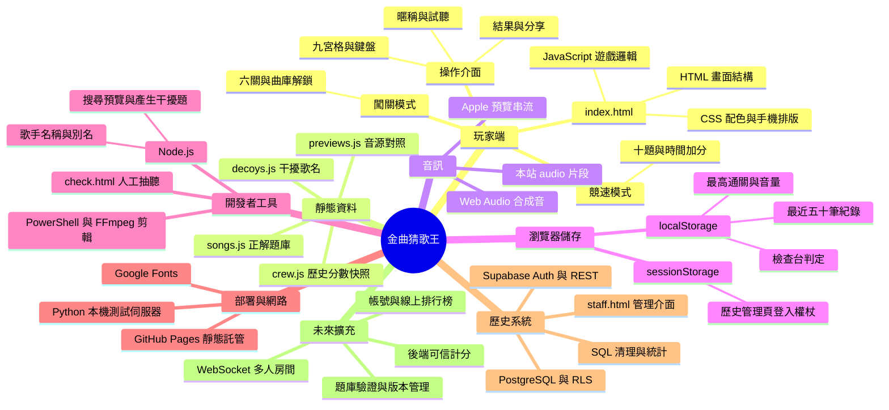

# 猜歌遊戲架構導覽

這個專案的製作模型是「靜態網頁＋瀏覽器內的遊戲引擎＋預先整理的歌曲資料」。網站主機只發送檔案，玩家的瀏覽器自己抽題、播放音樂、判斷答案、計時、計分，最後把紀錄存在本機。它適合單人活動遊戲；目前沒有負責裁判的應用後端，也沒有多人同步。

本文件以初階工程師為讀者，優先解釋元件責任、資料流與信任邊界，再對照程式。分析基準為 `b203a4b3d42b8f7867f2551b2a1cd0eeb7e5c1f2`，文件日期為 2026-10-22。這次只新增文件，未改動遊戲、資料產生工具或資料庫設定。

## 建議閱讀順序

| 文件 | 要回答的問題 |
| --- | --- |
| [系統與技術架構](system-design.md) | 誰提供檔案？誰執行邏輯？Apple、瀏覽器與歷史 Supabase 各負責什麼？ |
| [遊戲流程與資料流](game-flow.md) | 如何選歌、產生選項、載入音樂、計時、計分和儲存？ |
| [檔案與功能對照](file-map.md) | 想改一項功能，要從哪個檔案、設定或函式開始？ |
| [未來改造建議](modification-roadmap.md) | 哪些能局部調整？哪些需要後端、權限設計或重新分工？ |

程式閱讀可從 [index.html](../../index.html) 的 `CONFIG`、`STAGES`、`buildQuestions()`、`prepareClip()`、`startGame()`、`answer()` 與 `finish()` 開始，再搭配上述文件。

## 先掌握三個邊界

1. **目前玩家遊戲**：`index.html` 載入四個靜態資料檔。沒有向 Supabase 上傳成績，也沒有在每題查詢 iTunes Search API。
2. **開發者整理資料**：Node.js 工具呼叫 iTunes Search API，產出預覽網址及干擾選項；人工使用 `check.html` 抽聽。這些是發佈前作業，不是玩家請求的後端。
3. **歷史排行榜**：`staff.html`、`board-config.js` 與 `sql/` 保留舊系統。只有管理頁仍有 Auth 與資料庫 API 呼叫；實際遠端服務是否仍可用，不能由原始碼確定。

原始碼中的「Fully offline」應理解成「遊戲規則與資料不依賴即時排行榜 API」。實際仍需取得網頁、Apple 音訊與選用的 Google 字型；沒有 Service Worker 或完整離線快取機制。

## 專案心智圖



讀法：中心是整個產品，每個分支代表一種責任，而非每個分支都會在遊戲中執行。尤其「開發者工具」在開發者電腦執行，「歷史系統」獨立於目前玩家流程。可把它想成一份涵蓋資料平面、管理平面與維運工具的網路設備盤點。

## 已盤點的規模

| 資料 | 實際內容 |
| --- | --- |
| 正解題庫 | 390 首；華語現代 200、經典 60、台語 30、韓文 42、西洋 40、日文 18 |
| 干擾選項 | 605 筆；只提供歌名，不需要音訊 |
| 預覽對照 | 390 筆，所有歌曲 ID 都有對照；不代表每個遠端網址現在都可播放 |
| 預覽配對信心度 | high 344、medium 41、low 5；這是字串規則評分，不是機器學習推論 |
| 幹部資料 | 46 筆；註解中出現的 55、56 等數字已與實際陣列不同 |
| 玩家分布 | 13,191 位歷史玩家的最佳分數，37 個累積分布節點 |

完整閱讀範圍包含三個 HTML 的畫面與腳本、所有 JS 資料與工具、SQL、PowerShell、CSV、README、LICENSE 和忽略規則；歌曲與預覽資料以程式載入全量資料盤點欄位、數量、ID 與對照。圖片是背景素材，不含遊戲邏輯。

## 本機閱讀與驗證

在專案根目錄執行：

```sh
python -m http.server 8000
```

用瀏覽器連線至本機 8000 埠，輸入 2–8 個字的暱稱、點「試聽」，再選模式。Python 只處理靜態 HTTP，不執行遊戲 JavaScript；Node.js 只在維護資料時需要。專案沒有 `package.json`、依賴安裝、打包流程或既有自動測試套件。README 記載的正式託管方式為 GitHub Pages 從 `main` 發佈，但 repository 內沒有自訂 CI workflow 可用來確認遠端 Pages 設定。

分析依據是原始碼與全量靜態資料盤點，並參考本次環境建置時的瀏覽器觀察：檔案服務成功；以測試用音源替代方式驗證過競速計分、本機保存與闖關初始化。當時 Apple 音訊與 Google Fonts 被環境出口政策阻擋，所以這些觀察不能證明正式音樂串流正常。本文的歷史資料庫權限分析是對 SQL 定義的檢視，未登入或變更遠端資料庫，也未驗證線上部署與真人多人行為。
