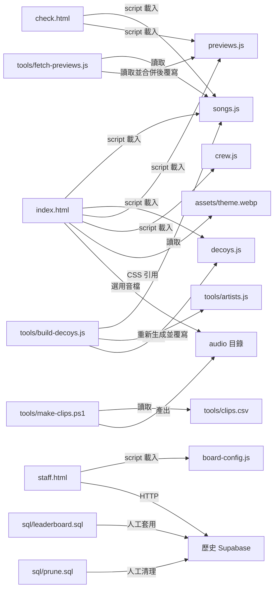

# 檔案與功能對照

[返回導覽](README.md) · [系統架構](system-design.md) · [遊戲流程](game-flow.md) · [改造建議](modification-roadmap.md)

## 1. 完整檔案盤點

| 檔案 | 用途與主要內容 | 誰讀取／何時執行 |
| --- | --- | --- |
| [index.html](../../index.html) | 主遊戲；內嵌 CSS、畫面 HTML、全部遊戲 JavaScript | 玩家瀏覽器開啟主頁 |
| [songs.js](../../songs.js) | 人工維護 390 首正解題庫，含 ID／歌名／歌手／genre | 主遊戲、音源檢查台、兩個 Node.js 工具 |
| [decoys.js](../../decoys.js) | 605 個干擾歌名，不直接出題，不需音源 | 主遊戲補選項 |
| [previews.js](../../previews.js) | 歌曲 ID 對 Apple 預覽 URL、商店資料、offset、信心度 | 主遊戲、檢查台；抓預覽工具讀取既有內容 |
| [crew.js](../../crew.js) | 46 名幹部分數、13,191 人母體及分數累積分布 | 主遊戲計算歷史比較 |
| [check.html](../../check.html) | 獨立音源抽聽頁；風險評分、搜尋、標記、匯出問題歌單 | 開發者瀏覽器；判定只在本機保存 |
| [staff.html](../../staff.html) | 舊排行榜管理介面；登入、全表分頁讀取、搜尋、排序、隱藏／恢復／刪除 | 管理者瀏覽器；呼叫 Supabase API |
| [board-config.js](../../board-config.js) | 舊 Supabase URL 與公開 anon key | 只有 staff.html 載入；主遊戲不讀 |
| [assets/theme.webp](../../assets/theme.webp) | 實際背景，84,404 bytes，約 82 KiB | index.html 的 CSS 背景 |
| [assets/theme.png](../../assets/theme.png) | 背景原稿，較大；主遊戲未引用 | 素材維護 |
| [audio/.gitkeep](../../audio/.gitkeep) | 保留空音檔目錄；非可播放素材 | Git 目錄佔位 |
| [tools/fetch-previews.js](../../tools/fetch-previews.js) | 搜尋 Apple、評估配對、合併並重寫 previews.js | 開發者以 Node.js 手動執行 |
| [tools/build-decoys.js](../../tools/build-decoys.js) | 按歌手查詢、排除題庫與重複歌名、覆寫 decoys.js | 開發者以 Node.js 手動執行 |
| [tools/artists.js](../../tools/artists.js) | genre 分組歌手、Apple 譯名／別名、knownArtist 正規化判斷 | build-decoys.js 的 CommonJS require |
| [tools/clips.csv](../../tools/clips.csv) | 340 首舊剪輯工作清單；id、title、artist、source、start | make-clips.ps1；不是遊戲題庫來源 |
| [tools/make-clips.ps1](../../tools/make-clips.ps1) | PowerShell 呼叫 FFmpeg，預設剪 15 秒、AAC 96k、44.1 kHz；可 Force 重剪 | 具 PowerShell／FFmpeg 的開發者環境；說明以 Windows 為主 |
| [sql/leaderboard.sql](../../sql/leaderboard.sql) | 舊分數資料表、CHECK、20 秒觸發器、索引、RLS、leaderboard view | 人工在 Supabase SQL Editor 執行；非玩家腳本 |
| [sql/prune.sql](../../sql/prune.sql) | 先存每日統計，再清理非最佳歷史資料及舊索引 | 人工維運；包含刪除，不是唯讀查詢 |
| [README.md](../../README.md) | 英文產品說明、執行方式、歌曲維護及歷史背景 | 開發者入口 |
| [LICENSE](../../LICENSE) | 程式碼 MIT；另列錄音與真實暱稱不在授權範圍 | 使用／改作前閱讀 |
| [.gitignore](../../.gitignore) | 忽略剪輯音檔、工具 log、部分設計草稿；保留 audio/.gitkeep | Git |
| docs/architecture/ | 本次新增五份架構分析文件 | 閱讀與審閱；不會載入遊戲 |

repository 沒有 package manifest、lockfile、自訂 `.github/workflows`、後端入口或自動測試資料夾。註解提到的 `clean-decoys.js` 不在目前 checkout，不能把它當作現成工具。

## 2. 檔案依賴圖

箭頭代表發出依賴的一方：例如主頁需要 `songs.js`，不是題庫主動啟動主頁。工具到資料檔的「覆寫」是磁碟操作；SQL 到 Supabase 是人工維運操作。兩者都不是玩家每次開頁就會發生。

## 3. index.html 的內部導航

| 區塊／函式 | 責任 | 修改時的連動 |
| --- | --- | --- |
| `<style>` 的 `:root`、`.screen`、`.grid`、`.opt` | 色票、字級、間距、畫面切換與九格排版 | 修改選項數要一起改 grid、動畫及鍵盤處理 |
| `screen-start/load/play/result/board` | 五個主要畫面 DOM；`pop` 為闖關對話框 | 保持 JS 使用的 id；刪改節點須查 `$()` 使用位置 |
| `CONFIG` | 競速題數、genre floor、選項數、時間、分數、揭曉間隔、示範音長度及歌手上限 | 分數與題數改動會影響稱號、門檻、靜態比較；舊 DB 約束如重啟亦需同步 |
| `STAGE_SECONDS`、`STAGE_QUESTIONS`、`STAGES`、`ALL_GENRES` | 闖關時間、題數、門檻、可用曲庫、解鎖保證 | 不是所有值都沿用 CONFIG；硬編碼「六關／十題」文案也需盤點 |
| `stagePool()`、`stageHudLabel()`、`show()` | 可用題庫、關卡提示、DOM 畫面切換 | 新增 genre 要處理關卡、floor、顯示與資料工具 |
| `shuffle()`、`buildQuestions()`、`cleanTitle()`、`titleKey()` | 抽題、干擾選項、去重與答案位置 | 受資料量及 genre 分布影響；不要只測一次隨機輸出 |
| `ensureCtx()`、`note()`、`synthClip()` | Web Audio 試聽與合成音 | 與實際 Apple 音訊來源不同 |
| `probeAudio()`、`prepareClip()`、`playClip()`、`onPlayBlocked()` | 音源載入、快取、播放、瀏覽器阻擋提示 | 注意第一首與後續題目的不同策略 |
| `setVolume()`、`VOL_KEY` | 同步兩處滑桿、已準備音訊及本機保存 | 音量不是全系統音量，只控制此頁播放器 |
| `G`、`R` | 正在進行的遊戲狀態與規則 | 重整即消失，不能當多人共享狀態 |
| `nickError()`、`refreshStartBtn()`、`btn-test` 事件 | 首頁輸入與聲音確認 | UI 規則不等同遠端驗證 |
| `startGame()`、`playRound()`、`loadFirst()`、`nextQuestion()` | 從模式選擇到每題進場 | 新增暫停／重連要定義這些狀態如何轉移 |
| `tick()`、`answer()` | 計時、鎖定、判分、揭曉 | 可信競賽需把裁判責任移到後端 |
| `Store`、`finish()`、`TITLES` | 本機紀錄與競速結果 | 最近 50 筆淘汰、歷史百分比、硬編碼文字 |
| `finishStage()`、`failStage()`、`stageFacts()` | 通關判定、紀錄、彈窗與失敗結果 | 分數每關歸零，最高通關不代表可續關 |
| `beatCount()`、`beatPercent()`、`crewBeaten()`、`crewNext()` | 靜態歷史比較 | 調分數刻度會令舊快照失去可比性 |
| `renderBoard()`、`crewRowHtml()`、`escapeHtml()` | 幹部榜、本機插列及部分 HTML 跳脫 | 外部題庫若可自由輸入，需要全面檢查 HTML 輸出點 |
| `shareLine()`、`doShare()`、`toast()` | 系統分享、剪貼簿、提示訊息 | 無後端結果頁；安全內容環境與瀏覽器支援有差異 |
| `keydown`、boot | 1–9 答題及初始化音量／按鈕 | 改操作方式需與觸控、鍵盤及輔助功能一起檢查 |

## 4. 想改功能，從哪裡開始？

| 目標 | 起點 | 同時檢查 |
| --- | --- | --- |
| 顏色、背景、按鈕與手機排版 | index.html CSS、assets/theme.webp | 圖片大小、對比、長歌名、窄螢幕及減少動態效果偏好 |
| 首頁、結果文案與活動資訊 | index.html HTML 與結果函式 | 稱號、關卡彈窗、分享文字中的硬編碼內容 |
| 競速秒數／題數／加分 | CONFIG | R、滿分、TITLES、crew.js 歷史刻度、相關文字 |
| 闖關難度 | STAGES、STAGE_SECONDS、STAGE_QUESTIONS | genres、floor、題庫實際分布、過關文案 |
| 新增／刪除歌曲 | songs.js | 唯一穩定 ID、previews.js 對照、干擾去重、check.html 抽聽 |
| 新增 genre | songs.js 與主頁設定 | ALL_GENRES／STAGES／floor、artists.js、檢查台、素材工作清單 |
| 干擾選項與同名歧義 | decoys.js、buildQuestions()、cleanTitle() | build-decoys.js 會整份覆寫，需審查生成差異 |
| 搜尋來源與配對品質 | tools/fetch-previews.js、artists.js | Apple 地區、別名、搜尋結果評分、人工抽聽 |
| 某首歌的開始位置 | previews.js 的 offset | 起點是「預覽片段內」秒數，不是原曲完整時間 |
| 自有音訊／剪輯長度 | tools/clips.csv、make-clips.ps1、audio/ | 權利、FFmpeg、實際答題停止條件、本地探測最佳化 |
| 試聽音與缺檔示範音 | note()、synthClip()、btn-test 事件 | 示範音不是原曲，不可當修復音源的替代品 |
| 換成自己的靜態幹部榜 | crew.js | 真實暱稱隱私、CREW_TOTAL 與 SCORE_DIST 要相符 |
| 線上排行榜 | 新增後端整合；歷史 SQL 僅作參考 | 不能只填 board-config.js：主頁已沒有提交／讀榜邏輯 |
| 多人房間／對戰 | 新的權威伺服器與通訊協定 | 不只是新增一顆按鈕或共用 localStorage |

資料維護指令會修改檔案，應在獨立的功能工作中執行並審閱差異；本次文件任務沒有執行產生器、剪輯器、SQL 或變更資料。
