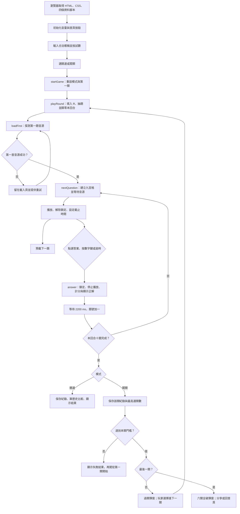
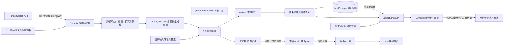

# 遊戲流程與資料流

> 版本註記：本文分析原始版本 `b203a4b`。新版已移除歷史比較、改為全語系開放、加入跨場輪替，並擴充至 725 首（含宮崎駿電影配樂 20 首）；現行規則見 [專案 README](../../README.md)。下方程式連結固定指向原始版本，供對照。

[返回導覽](README.md) · [系統架構](system-design.md) · [檔案對照](file-map.md) · [改造建議](modification-roadmap.md)

## 1. 從載入到結束的流程圖



圖中的「回合」指競速的一場十題，或闖關的一關十題。過關後下一關會重新計分，並非一路累加到六萬分。第一首失敗是阻擋流程；後續題目取不到音訊時仍可用替代音繼續，這兩個分支不能混為一談。

## 2. 開啟網頁：先裝資料，再啟動事件

瀏覽器解析 HTML 與 CSS，下載背景與字型，依序執行 `songs.js`、`decoys.js`、`previews.js`、`crew.js`。主程式接著宣告規則、狀態與各種函式，綁定按鈕／鍵盤事件，最後執行 `setVolume(volume)` 與 `refreshStartBtn()`。

`show()` 只隱藏或顯示 DOM 節點，所以切到結果頁沒有額外的 HTML 導航請求。可類比同一台設備的管理介面切分頁，背後仍是同一份執行狀態。

暱稱規則是去除前後空白後 2–8 個 JavaScript 字串長度單位，並比對一小份禁用字串；emoji 的長度可能與人類看到的字數不同。試聽按鈕透過 Web Audio 合成短琶音，設定 `G.soundOk = true`，讓玩家確認裝置音量，也利用使用者手勢啟動 AudioContext。這並未測試 Apple 音源是否連得上。首頁按鈕依暱稱與 `soundOk` 啟用；`startGame()` 本身只再驗證暱稱，並非安全檢查。

## 3. 模式如何轉成規則

競速從 `CONFIG` 填入 `R.questionCount = 10`、`R.timeLimit = 12`，題庫是全部 `SONGS`。闖關使用 `STAGE_QUESTIONS = 10`、`STAGE_SECONDS = 12`，由 `stagePool()` 按 genre 選可用歌曲。

| 關卡 | 本關門檻 | 可當正解的類型 | 最低出題保證 |
| --- | --- | --- | --- |
| 1 | 4,000 | mando、classic | 無指定 floor |
| 2 | 5,000 | 上述＋tw | tw 至少 1 |
| 3 | 6,000 | 上述＋west | tw、west 各至少 1 |
| 4 | 7,000 | 全部＋kpop、jp | tw、west 各 1，kpop／jp 合計至少 1 |
| 5 | 8,000 | 全部 | 同第 4 關 |
| 6 | 9,000 | 全部 | 同第 4 關 |

關卡表的 `unlocked` 是「進入這關解鎖什麼」，顯示於上一關過關彈窗。第 4 關起已開全曲庫，第 5、6 關主要提高門檻，不再增加 genre。`G.stage` 記目前關號，Storage 記的是已通過的最高關數。

## 4. 隨機抽歌：有保證的隨機，不是平均輪播

`buildQuestions(songs, floor)` 執行兩階段抽題：

1. 依 floor 的順序，從指定 genre 或 `+` 聯集抽取最低數量。例如競速 `{ mando: 5, classic: 1, tw: 1, 'kpop+west+jp': 1 }` 先取 8 首；後者是三類合計一首，不是每類一首。
2. 從剩餘可用歌曲補足十題，再洗牌整個出題順序。同回合透過物件參照避免重複取歌；不同回合沒有避免重複的歷史紀錄。

`shuffle()` 用 Fisher–Yates 洗牌及 `Math.random()`。這適合單機娛樂，不是可驗證公平或密碼學亂數；沒有固定種子讓不同玩家抽到相同回合。只有合成示範音使用歌曲 ID 產生的固定種子，與正解抽樣無關。

floor 是最低值，不是比例上限，所以競速可能超過一首台語。類型不足時程式改從剩餘歌曲補足，不會報出「未達保證」。若改設定讓 floor 總和超過題數，程式沒有截斷；若整個題庫不足，也可能產生少於預期的題目。這些是資料維護要驗證的不變條件，不是目前 390 首題庫已知必然發生的故障。

## 5. 答案生成：讓九宮格有辨識難度

對每一題，先把正解物件放進 `options`，再從 `SONGS + DECOYS` 補選項。因此闖關的「正解題庫」受解鎖限制，但干擾選項池仍含所有 genre；它沒有把整個選項池也鎖在本關。

補選項分三次嘗試：先同 genre、同歌手最多 `CONFIG.maxSameArtist = 2` 格；不夠就跨 genre 保持歌手上限；仍不夠才放寬歌手上限。這是軟限制，不是無條件保證。`cleanTitle()` 移除括號字幕、帶空白的破折號後綴；`titleKey()` 再轉小寫，避免兩首歌清理後在畫面看起來同名。不能靠「沒有電影副標題的那格」猜正解。

最後洗牌九個選項，若正解位置剛好與上一題相同，就隨機交換到另一格；這只避開連續同位置，不保證整場位置均勻。選項按鈕顯示歌名而非歌手，字體依字串長度縮小。九宮格排版和鍵盤 1–9 都寫死為九格，不能只改 `optionCount` 就認為整套介面會同步支援其他格數。

答案判斷是 `opt === q.song`，即 JavaScript 物件參照相等，不是再比對歌名。可以想成同一筆記憶體物件的身分比對；如果未來經過 JSON 傳輸或重新複製物件，應改用穩定的歌曲／選項 ID。

## 6. 音訊準備與播放

`prepareClip()` 先檢查快取，未試過才依序探測本站 `audio/<id>.m4a`，失敗後查 `SONG_PREVIEWS[id].url`。`hasLocalAudio` 在第一次本地探測失敗後設為 false，後面不再逐首探本地檔；因此只有部分歌曲有本地檔時，不保證每首都會優先用到本地版本。這是在空音檔目錄情境下減少 404 的最佳化。

`probeAudio()` 建立 Audio 元素，設定 `preload='metadata'` 後 `load()`，等待 `loadedmetadata`、`loadeddata` 或 `canplay` 任一事件，不等整個檔案下載完。成功才切到 `preload='auto'`。就像先確認串流端點開始回應，不等於後續所有封包一定準時到達。

| 條件 | 實際行為 |
| --- | --- |
| 本地檔探測 | 每次最多等 2.5 秒；可能因 error 提早返回 |
| 第一首遠端音訊 | 最多等 25 秒；無音源留在載入頁、顯示重試，不直接合成開局 |
| 後續遠端音訊 | 預設最多等 12 秒；失敗則 `q.audio = null` |
| `q.audio` 成功 | 保存 `{ el, source, offset }`，重用已準備播放器 |
| 後續題目音源失敗 | 顯示「示範音」，用 `synthClip()` 合成與歌曲 ID 綁定的旋律；不是該歌曲的旋律 |
| Audio 的 `play()` 被阻擋 | 顯示提示，等下一次 pointerdown 再試；計時不會自動暫停 |

`playClip()` 在遠端預覽的 `offset` 起點呼叫 `play()`，作答或逾時後呼叫 `pause()`。Apple 提供約 30 秒預覽，設定 `clipSeconds = 15` 只直接控制合成音長度；目前真實媒體沒有獨立「15 秒切斷」計時器，而是通常由 12 秒答題截止或提早作答停止。

`nextQuestion()` 等準備完成後就啟動計時，不會等待 `play()` Promise 確認播放成功；所以媒體中途卡住、重新 buffer 或瀏覽器阻擋時，時鐘仍前進。每題開始後預載下一題，沒有一次下載十首。`prepareClip()` 只快取完成結果，未保存進行中的 Promise，若預載尚未完成就再次呼叫，可能重複探測。這些限制對單人遊戲可接受的程度，需依實際網路與裝置測試決定。

## 7. 計時與計分

當題目準備好，`G.locked = false`，設定 `G.deadline = performance.now() + R.timeLimit * 1000`。`tick()` 用 `requestAnimationFrame()` 更新顯示，重新用截止時間減目前時間計算剩餘秒數，不是每次把變數減 0.1；這能減少回呼頻率不固定造成的漂移。

`performance.now()` 是本機單調時間，不受一般校時更改牆鐘的方式影響，但不具伺服器可信性。切背景分頁會節流動畫回呼；回來時計算剩餘時間可歸零，不會因此公平地暫停，也無法作多人同步時鐘。

玩家點選、按 1–9，或剩餘時間歸零後都走 `answer()`。它先檢查 `G.locked`，立刻鎖定、取消動畫計時並停止聲音，避免同題重複記分。

```text
答對單題分數 = round(300 + 700 × 剩餘秒數 / 本題秒數)
答錯或逾時 = 0
```

以 12 秒為例，剩 6 秒答對是 650 分；接近立刻答對可接近 1,000 分；十題理論滿分 10,000。兩種模式共用這個公式。`G.log` 記下正解、是否答對、得分與經過秒數，DOM 標上 right／wrong／fade，再等 `revealMs = 2200` 毫秒切下一題。揭曉時間不算在下一題倒數。

## 8. 結果、儲存與分享

競速 `finish()` 把摘要寫進 `Store`，選擇 `TITLES` 中第一個符合最低分的稱號，列出答錯歌曲。稱號表按門檻由高到低，最後要有 min 0。幹部比較採嚴格大於，平手不算擊敗；下一個目標是尚未超過的最低分幹部。

`beatCount()` 在 `SCORE_DIST` 相鄰節點間做線性插值，除以 `CREW_TOTAL` 後四捨五入。這是與歷史快照比較的近似百分比，不是把這次成績上傳後重新排序所有線上玩家；新玩家不會改變分布。

闖關 `finishStage()` 每關先保存結果。通過就記已通關的關號，未通過記前一關，更新只增不減的 `pmsg_stage_v1`。通關彈窗等玩家按下一關才增加 `G.stage` 再抽題；沒過或重啟闖關都從第 1 關開始，不會由最高通關紀錄續玩。

`renderBoard()` 取固定幹部榜，再把本機最佳競速成績插入適當位置。`G.nickname` 是本次頁面記憶體的暱稱，插入的分數卻可能來自較早紀錄，因此不是嚴格綁定帳號／暱稱的榜單。重整後該列可能顯示「你的最佳成績」。

分享先呼叫 `navigator.share()`，不支援或失敗再複製「文字＋目前網站 URL」到剪貼簿，最多等 1.5 秒，仍失敗則提示截圖。使用者取消分享直接返回。分享沒有建立伺服器結果頁，也沒有防偽簽章，接收者看到的是自述成績。

## 9. 資料流圖：哪些資料離開瀏覽器？



這張圖以資料內容而非按鈕順序為主。暱稱、答案與分數在目前程式沒有送往遊戲 API；音訊請求則真的會離開瀏覽器，來源服務仍可觀察網路請求與依瀏覽器政策提供的標頭。「沒有上傳成績」不等於「完全沒有對外連線」。Storage 像端點本機記錄，不能當集中式稽核軌跡。

## 10. 發佈前的素材流程

`fetch-previews.js` 用歌名＋歌手搜尋 iTunes，規則對標題及歌手加分，對 live、cover、特定專輯字樣扣分，挑出帶 previewUrl 的最佳結果。達門檻後標成 high／medium／low，保存網址、商店資訊與 offset。預設只補缺少 ID；`--only` 即使未加 `--force` 也會重抓指定 ID；`--force` 無指定 ID 時重抓全部。成功資料合併進現有對照，最後整份序列化寫回 `previews.js`。

`build-decoys.js` 從 `artists.js` 的 genre 分組搜尋歌手，過濾 live 等曲目，用 `knownArtist()` 的清單／別名辨識結果，再排除題庫歌名與重複歌名。它會從頭建立並**覆寫整份 `decoys.js`**，不是增量合併；既有手動修正不保證保留。`knownArtist()` 接受任一已知歌手／別名的子字串配對，不是嚴格證明結果正好屬於本次搜尋歌手。

兩個工具都有延遲與 HTTP 非成功重試，但單筆失敗會記錄後繼續；即使多筆失敗也可能寫出部分結果、程序正常結束。不能只看 exit code 就認定資料更新完整。`check.html` 提供風險篩選、人工標記與匯出重抓指令；只播放遠端預覽，不檢查 `audio/` 本地優先路徑，也不會把 ok／bad 自動回寫到資料檔。

自有音源由 `clips.csv` 配合 PowerShell 與 FFmpeg 剪成 AAC／M4A。目前 CSV 是 340 筆舊清單、source／start 未填，沒有自動隨 390 首題庫同步；它不是當前遊戲的出題來源。授權與素材管理見 [改造建議](modification-roadmap.md)。
