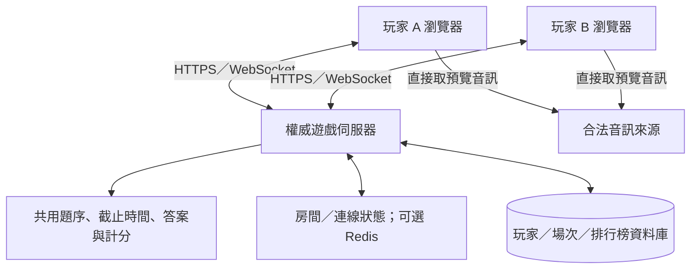

# 未來改造建議

> 版本註記：本文分析原始版本 `b203a4b`。新版已移除歷史比較、改為全語系開放、加入跨場輪替，並擴充至 725 首（含宮崎駿電影配樂 20 首）；現行規則見 [專案 README](../../README.md)。下方程式連結固定指向原始版本，供對照。

[返回導覽](README.md) · [系統架構](system-design.md) · [遊戲流程](game-flow.md) · [檔案對照](file-map.md)

本文件區分「現有程式可調設定」、「應另開工作修正的限制」與「未來才需要的新系統」。本次只分析，不新增功能、不套用 SQL，也不測試遠端寫入或刪除權限。

## 1. 改動成本與影響

| 改造 | 相對成本 | 原因與需要注意的連動 |
| --- | --- | --- |
| 更換背景、色票、活動文案、稱號 | 低 | 主要在 HTML／CSS／TITLES；仍需手機版與文字溢出檢查 |
| 增加少量歌曲、修正某首預覽、換靜態幹部榜 | 低到中 | 結構現成，但要查 ID、音源、干擾去重及授權；不是只貼歌名 |
| 調整時間、分數、genre floor、關卡門檻 | 中 | 設定集中，卻與滿分、文案、歷史比較及舊 SQL 約束耦合 |
| 題數或九宮格改版 | 中 | 題數影響曲庫與結果；選項數還涉及 CSS 九格、逐格動畫、鍵盤與文字尺寸 |
| 暫停、背景切換、音訊重試／切歌 | 中 | 須明確管理計時、播放與鎖定狀態，避免無聲倒數或舊回呼操作新題 |
| 本機自訂題庫匯入／匯出 | 中 | 可維持純前端，但需要 schema、內容驗證、大小限制、版本與安全顯示 |
| 跨裝置紀錄、帳號、即時排行榜 | 高 | 新增 Auth、後端 API、資料庫、存取政策、濫用控制及成本監控 |
| 多人同步對戰、可信競賽 | 高 | 抽題、時間、判分要移到可信後端，並新增房間與即時協定 |
| 使用者上傳／共享音檔 | 高 | 額外需要物件儲存、上傳授權、檔案檢驗、配額、版權與內容管理 |

相對成本是架構範圍評估，不是工期承諾。若只做活動用單人遊戲，不需要為了「現代化」先導入大型前端框架或完整微服務。

## 2. 可維護性：先分責任，再決定框架

目前單檔主頁讓部署與閱讀入口很簡單，規則大多集中於 `CONFIG`、`STAGES`，四份資料也已分離。缺點是 UI、規則、音訊、Storage 與分享透過全域狀態互相依賴，三個 HTML 又複製了色票、音源探測與字串處理，修正容易不同步。程式註解、硬編碼人數及生成器行為也已有差距。

可分階段把 CSS、資料存取、純規則函式、音訊服務、儲存介面與畫面控制拆開，先保持現有介面與行為。之後才評估 ES modules、TypeScript 或前端框架：modules 可清楚宣告依賴；TypeScript 可檢查欄位與狀態類型；框架協助較複雜 UI 同步，但三者都不會自動提供可信計分或後端安全。

值得建立的驗證是：不同關卡題數正確、同回合 ID 不重複、floor 有足夠資料可達成、清理後的選項不重名、正解位置不連續相同、分數邊界、闖關通過／失敗，以及 Storage 格式不正確時的處理。音訊與流程要測來源失效、播放被阻擋、慢網路、切背景與連續切題。這些能驗證需求；只測「某函式被呼叫」幫助有限。

## 3. 效能與可用性

| 現況 | 好處 | 限制與改進方向 |
| --- | --- | --- |
| 靜態主機、無玩家 DB 查詢 | 容易快取；沒有每次開榜掃描資料庫的 egress | 不提供即時資料；需考慮版本與快取更新一致性 |
| 約千筆選項資料全載入 | 不用逐題 API，互動快 | 曲庫放大後下載、解析與重複洗牌成本上升；可按語系／曲庫分包與索引 |
| 背景用 WebP | 比 PNG 原稿小 | 首屏流量還包含 HTML、JS、字型；不能把舊註解的圖片占比視為當前實測 |
| 每題預載下一題 | 在記憶體／流量與延遲間折衷 | 進行中請求沒有 Promise 共用，可能重複載入；需取消與資源釋放機制 |
| 等 metadata 即進題 | 不必等待整段下載 | 播放未成功就倒數，串流停頓也不暫停；可增加明確音訊狀態與超時規則 |
| 本地音檔首次失敗就跳過後續探測 | 空目錄時減少 404 | 混合本地／遠端曲庫可能錯過現有本地檔；可改成明確音源清單 |
| 純本機 Storage | 快速且不用登入 | 同步、容量、資料格式、寫入失敗與竄改都需另處理 |

目前 `buildQuestions()` 對每題過濾／洗牌選項池，還用 `picked.includes()` 去重；在 390＋605 筆與十題規模合理，並不等於適合十萬首。擴大後可預先按 genre 建索引、用 Set 記錄 ID，再量測載入與抽題延遲。大量曲庫也不宜只靠 `window` 全域一次執行所有 JS 資料。

沒有 Service Worker、離線安裝或音樂離線授權方案。若要 PWA，應先區分可快取的本站靜態檔與不可擅自持久保存的第三方媒體；不能把 Apple 試聽預覽直接下載重發當作無成本離線功能。

## 4. 資安與信任邊界

### 4.1 玩家端不是可信裁判

正解、分數公式、倒數與結果都在玩家可控制的瀏覽器中。使用者可透過開發工具修改 JS、記憶體及 localStorage，所以禁用按鈕、`G.locked`、暱稱黑名單只提供操作體驗。它類似把防火牆規則的最終裁決交給不受管端點：規則寫得再完整，也不形成伺服器的信任邊界。

單人自娛不一定需要防作弊；若公開競賽，伺服器應擁有題目狀態、截止時間、答案驗證及分數計算，不能接受前端傳來的總分作為事實。即使伺服器不發正解，歌曲 ID、可讀的預覽 URL 與搜尋能力仍可能洩漏線索；後端權威只能提高成本，不能保證防住外部辨識、人工協助或音樂辨識工具。

### 4.2 HTML 輸出與輸入驗證

主頁用 `textContent` 產生選項、提示，幹部名稱經 `escapeHtml()`，管理頁也有 esc。但競速與闖關結果的答錯清單直接以 `innerHTML` 插入歌名／歌手，檢查台的 genre 亦直接拼接。因此現有手工審查靜態資料是隱含的信任來源；若開放使用者題庫，惡意文字可能變成儲存型／DOM XSS 的輸入。

新增匯入時應用 schema 驗證欄位與長度、只接受允許的 genre／URL 協定與來源、以 DOM `textContent` 顯示純文字。不要使用 `eval()` 載入使用者提供的「JS 題庫」。HTTPS／CORS 不會自動阻止 XSS；同源腳本仍可讀取 Storage，包括同 origin 的管理頁 token。

### 4.3 歷史 Supabase 政策需重新審視

以下是 repo SQL／管理頁的具體觀察，不是已驗證遠端漏洞：

| 觀察 | 意義與處理建議 |
| --- | --- |
| `anon`、`authenticated` SELECT 的條件為 true | 可以讀底表所有列，含 hidden、device_id；hidden 是 UI／view 篩選，不是保密控制。若資料敏感，限制底表並提供必要欄位／聚合 API |
| 所有 `authenticated` 都可 UPDATE／DELETE | 沒有 staff allowlist／role 檢查；若允許一般註冊，普通使用者也可能取得管理權。應用獨立 staff 授權政策並限制帳號發放 |
| 公開插入與分數 CHECK | 只擋不合理值，攻擊者仍能提交範圍內假分、選任意 device_id；不是可信計分 |
| 20 秒裝置觸發器 | 裝置 ID 可更換；先查再插入亦非完整並發限流。需後端身分、併發控制與入口限流，不能只靠此觸發器 |
| INSERT 未固定其他欄位 | 定義未拒絕使用者自帶 created_at、hidden 等值；速率及時間語意不宜依賴用戶可控資料。改用受限 API／欄位權限與伺服器時間 |
| sessionStorage access token | 比永久保存少留一份長期狀態，但仍可被同源 XSS 讀取；沒有 refresh／伺服器登出流程。應定義過期、撤銷與管理帳號 MFA |
| UI 把匿名讀取藏在登入頁後 | 隱藏 DOM 不限制直接呼叫 API；授權必須由後端／RLS 執行 |

`board-config.js` 的 anon key 原本就是公開客戶端識別資料，不應誤稱為 service-role 密鑰外洩；文件不複製 key。未來的 service-role／資料庫管理密鑰只能放在後端或安全環境設定，不能放到靜態 JS。對 RLS 的修改需要獨立設計、最小權限測試與部署審閱。

### 4.4 管理工具的資料完整性與操作範圍

`staff.html` 的 `fetchAll()` 以單欄 `created_at` 游標讀取，時間戳同值跨頁時可能漏列；最多 60,000 筆，沒有明確提示截斷。適合改用 `(created_at, id)` 穩定複合游標、後端分頁／搜尋與明確讀取上限回報。

還有一個可由程式直接看出的範圍不一致：`render()` 使用 `view().list.slice(0, SHOW_MAX)` 決定畫面及批次按鈕文字，但點擊事件用 `bulkTargets(view().list)`，沒有相同的 300 列截斷。因此超過 300 筆符合條件時，實際批次動作可能影響畫面未列出的玩家；若是下架，同一裝置的其他場次也會納入。這與註解宣稱「只影響看得到的範圍」不一致。應在另開修正工作中讓預覽、確認與執行共用同一組目標 ID，並測試超過顯示上限的情境。本次未執行任何管理動作。

`prune.sql` 的先統計、再刪除不是備份：日計數不保留原始每筆資料。正式啟用前需要可還原備份、權限分離、稽核與排程；不能因為說明寫可重跑，就把資料刪除當作可逆。

### 4.5 隱私、外部依賴與部署

`crew.js` 含真實成員暱稱與分數，fork 後應替換或取得適當授權；`noindex, nofollow` 只是搜尋引擎提示，不是存取控制。第三方字型與音訊服務會接收連線，隱私說明應反映這點。若需要更嚴格流量控管，可依[系統網域表](system-design.md)制定出口規則與檢查失敗提示。

若主機支援安全標頭，可規劃 CSP（限制 script、style、font、media、connect 來源）、Referrer-Policy、frame 限制等；現有大量 inline script/style 需要先拆分或管理 hash，直接套用嚴格政策會讓遊戲失效。GitHub Pages 的自訂回應標頭能力有限，必要時改用可控 CDN／主機。這些是部署建議，不是目前已存在的防護。

## 5. 加入線上排行榜

最低需求是成績提交 API、可信玩家／訪客身分、資料庫與排行榜查詢；若要降低作弊，還要由後端管理每場題目、作答時序及計分。

可以使用 Supabase Auth＋PostgreSQL＋受控 Edge Function／自建 API，但應重新設計 RLS、staff 身分、限流與索引，不能直接把歷史 SQL 當安全完成品。主頁目前沒有上傳成績或線上查榜程式，因此只修改 `board-config.js` 不會恢復玩家排行榜。

建議存 `session_id`、玩家 ID、規則版本、題庫版本、模式、伺服器起訖時間及分數；以唯一提交 ID 做冪等性控制，避免網路重試造成重複記分。排行榜區分模式／規則版本，僅回傳公開欄位；top N 可快取，自己的名次獨立查詢，避免下載全表。若能接受非即時，定期生成靜態榜仍是低成本選項，不必每個讀取都打 DB。

## 6. 加入多人連線

推薦「權威伺服器＋WebSocket 房間」模型。WebSocket 提供雙向訊息通道；HTTP API 處理建立房間、登入與查詢，WebSocket 傳送 ready、回合開始、作答、揭曉及分數。Socket.IO 是可選的協定／框架，不是必要條件；PostgreSQL 保存持久資料，Redis 可在多個服務節點間管理短期房間或訊息，初期單節點未必需要 Redis。

圖中兩個玩家不互相信任，也不互傳最終分數；伺服器是共同裁判。音訊仍可直接下載，但需先設計媒體準備與統一開始策略。這像集中管理的網路控制面：客戶端回報事件，中央控制面決定有效狀態。

需先定義的規則包括：房間狀態機（等待／準備／作答／揭曉／結束）、所有人是否載入完成、最慢玩家超時、斷線重連、離房、重複訊息、回合 ID／序號、防重放、伺服器收件截止、延遲補償及作弊模型。瀏覽器時鐘只能顯示估算倒數，後端用自己的時間判決。Apple 串流開始時間與行動網路延遲不一致，單純廣播「現在開始」無法保證大家同時聽到同一個位置。

WebRTC 適合點對點媒體／資料傳輸，但本遊戲的主要問題是可信狀態同步，初期通常不需要自行做 P2P 或語音媒體伺服器。若新增語音聊天，才另行評估 WebRTC、STUN／TURN 與隱私。

## 7. 加入自訂題庫

可依需求逐步提升：

1. **開發者題庫**：延續目前 `songs.js`、工具及人工審閱，增加 ID／genre／網址／重複檢查和版本。成本最低。
2. **玩家本機題庫**：用 JSON 檔匯入／匯出；前端先驗證 schema、資料量、唯一 ID、可用選項與可接受來源。小設定可用 localStorage，大量資料或 Blob 可用 IndexedDB（瀏覽器結構化資料儲存）。不代表能跨裝置共享。
3. **多人共享題庫**：新增題庫 API、資料庫、擁有者與編輯／發佈權限、審核／版本、配額與封鎖；音檔放物件儲存而非 DB 大欄位。後端若代抓任意音源 URL，要限制協定與目的地、防止 SSRF 存取內網；直接前端匯入也要處理來源追蹤與隱私。

錄音與試聽內容的權利不隨程式 MIT 授權移轉。不要把可串流預覽理解成可自由再散布／儲存；自有上傳需明確權利、檔案類型與大小驗證、內容檢查及必要的轉碼流程。API 回傳歌名／歌手仍可能配到翻唱或錯誤版本，人工抽聽依然有價值。

## 8. 建議實作順序與驗收

| 階段 | 工作 | 可驗收結果 |
| --- | --- | --- |
| 目前：文件分析 | 保留遊戲，建立架構與限制說明 | 五份文件可互連，Mermaid 可解析，變更僅 docs |
| 下一步：穩定單人基礎 | 核對硬編碼文案、Storage 最佳分數策略、音訊載入狀態及管理頁範圍問題 | 有針對需求的案例，慢網路與失敗提示可重現；各修正獨立審閱 |
| 再下一步：可維護資料與模組 | 分離純規則、音訊與儲存；增加資料 schema 與產生結果檢查 | 同一批規則案例在拆分前後相符，生成差異可審查 |
| 需要共享時：後端 MVP | 帳號／訪客身分、可信提交、限流、榜單快取與最小權限 | 用戶只能操作自己的場次；假分／重放／越權在伺服器被拒絕 |
| 需要對戰時：房間與同步 | WebSocket、權威計時、重連及媒體同步策略 | 至少雙客戶端在慢網路／重連下能一致結束同一回合 |

先決定遊戲的信任需求，再選技術：單人社團活動可以維持純靜態；需要跨裝置資料才增加雲端儲存；需要競賽公平與同步時，才把規則裁決移到可信伺服器。這樣能保留現有低維運成本的優點，也讓新增元件都有清楚目的。
