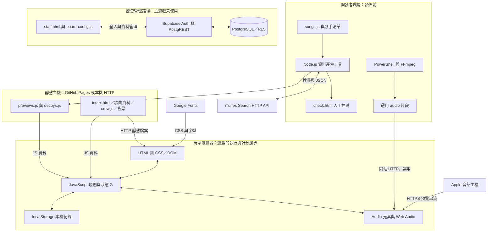

# 系統與技術架構

[返回導覽](README.md) · [遊戲流程](game-flow.md) · [檔案對照](file-map.md) · [改造建議](modification-roadmap.md)

## 1. 系統責任與執行位置

主遊戲是沒有框架的前端應用，使用一般 HTML、CSS 與 JavaScript，沒有 React、Vue、Unity、Canvas 遊戲引擎或 AI 模型。網頁中的按鈕與文字本身就是遊戲畫面；瀏覽器提供畫面更新、時間與音訊能力。

| 技術／元件 | 執行位置 | 在此專案的責任 | 網路工程類比 |
| --- | --- | --- | --- |
| HTML | 瀏覽器解析 | 定義首頁、載入頁、作答頁、結果頁、幹部榜及過關彈窗 | 描述介面與欄位的結構配置 |
| CSS | 瀏覽器排版 | 顏色、字體、九宮格、手機適配與動畫 | 介面的顯示規則，不是封包處理邏輯 |
| JavaScript | 玩家瀏覽器 | 處理點擊、抽題、播放、倒數、計分、儲存與分享 | 在端點執行的應用程式 |
| DOM | 瀏覽器記憶體 | HTML 解析後的物件樹；JS 可找到並修改節點 | 執行中的物件狀態，可供程式操作 |
| GitHub Pages／靜態 HTTP | 網站主機 | 回傳 HTML、JS、圖片與選用本地音檔 | 發送固定內容的 Web Server |
| HTMLAudioElement | 玩家瀏覽器 | `new Audio(url)` 解碼及播放本地／遠端音訊 | 媒體播放器向來源主機取流 |
| Web Audio API | 玩家瀏覽器 | `AudioContext`、振盪器、濾波與音量控制，產生試聽音及替代音 | 本機訊號產生與處理，不需音訊伺服器 |
| localStorage | 玩家瀏覽器 | 保存音量、近期成績、最高過關紀錄 | 端點的本機設定檔，使用者可修改 |
| Node.js | 開發者環境 | 執行預覽搜尋／干擾題生成工具，使用內建 `fetch`、`fs` | 離線維運腳本，不是常駐服務 |
| PowerShell＋FFmpeg | 開發者環境 | 依 CSV 剪輯自有錄音 | 批次素材處理工具 |
| SQL／PL/pgSQL | 歷史 Supabase PostgreSQL | 分數表、RLS、限制、觸發器、檢視及清理 | 資料庫政策與維運程序 |

**API** 是程式可呼叫的介面，不一定代表遠端服務。例如 Web Audio API、DOM API 與 Storage API 都是瀏覽器內建介面；iTunes Search、Supabase REST 才是跨網路 HTTP API。玩家操作按鈕通常是觸發本地函式，不是送一個請求給遊戲伺服器。

## 2. 系統架構圖

圖中「玩家瀏覽器」是最大的運算節點。靜態主機不接收答案，也不裁決分數。開發者工具只把搜尋結果變成可發佈檔案；歷史管理路徑則有真正的後端與資料庫，但沒有連回目前主遊戲。

從網路角度看，頁面載入與媒體下載是兩條不同流量：遊戲檔案走本站，音訊直接走 Apple，沒有經過自建音訊 Proxy。這降低本站傳輸量，卻把音源可用性、連線品質及瀏覽器解碼能力變成外部依賴。

## 3. 目前有沒有後端與資料庫？

| 路徑 | 應用後端 | 遠端 API | 資料庫 |
| --- | --- | --- | --- |
| 目前 `index.html` 主遊戲 | 無；只有靜態檔案伺服器 | 沒有逐題搜尋／提交分數 API；有媒體和字型 HTTP 下載 | 無遠端遊戲 DB；僅本機 Storage |
| Node.js 資料維護 | 無常駐後端 | iTunes Search API | 寫回 JS 檔案 |
| `check.html` | 無 | 取預覽音訊；不自動寫回 GitHub | 判定存在該瀏覽器 localStorage |
| 歷史 `staff.html` | Supabase 代管服務 | Auth、PostgREST | PostgreSQL `scores` 等 |

因此「有 Web Server」和「有負責業務規則的後端」是不同問題。用 Python 伺服器開遊戲，只是讓瀏覽器能透過 HTTP 取得檔案，不會把計分移到 Python。

## 4. 程式分層與狀態

`index.html` 把三層放在同一檔案：`<style>` 管畫面、HTML 管元件、底部 `<script>` 管行為。沒有前端路由器；`show()` 改變五個 `.screen` 的 `hidden` 屬性，模擬頁面切換。網址不會隨每一題改變，重整也不會接續原來的回合。

四個資料檔以一般 `<script src>` 依序載入：`songs.js → decoys.js → previews.js → crew.js → 主程式`。它們把資料掛在 `window` 全域物件，類似應用先載入設定表再啟動。不是 ES module 的 `import`，也不是從 API 動態讀 JSON；因此改載入順序或全域名稱可能破壞依賴。

| 狀態 | 內容 | 存活時間 |
| --- | --- | --- |
| `CONFIG`、`STAGES` | 共用設定、關卡與分數門檻 | 此頁載入期間 |
| `R` | 本回合的題數、時間；由模式填入 | 頁面記憶體，可被下一回合覆寫 |
| `G` | 暱稱、模式、關卡、題目、索引、總分、作答紀錄、鎖定、音訊及計時控制 | 重整即消失 |
| `q.audio` | 未試過 `undefined`、確認失敗 `null`、成功時的播放器／來源／起點 | 該題的記憶體快取 |
| Storage | 跨重整保留的少數紀錄 | 依瀏覽器與儲存類型 |

JavaScript 以事件驅動：點擊、音訊 ready、計時回呼都排到瀏覽器事件迴圈。`async/await` 讓程式等網路結果時仍能更新「載入中」文字，並不是建立多個可信遊戲伺服器。`G.locked` 是避免重複作答的本地旗標，類似應用狀態鎖，不能當成安全授權。

## 5. 資料模型

| 資料來源 | 結構 | 為何拆開 |
| --- | --- | --- |
| `window.SONGS` | `{ id, title, artist, genre }[]` | 正解的權威清單，ID 連結音源；genre 供抽題與解鎖 |
| `window.DECOYS` | `{ title, artist, genre }[]` | 增加可混淆歌名，不增加音源維護量 |
| `window.SONG_PREVIEWS` | 以歌曲 ID 為 key，值含 `url, title, artist, album, offset, conf` | 分開人工題名與 Apple 回傳資訊，方便重抓與抽聽 |
| `window.CREW` | `{ name, score }[]` | 固定幹部比較基準；程式複製後由高到低排序 |
| `window.SCORE_DIST`／`CREW_TOTAL` | `[分數, 低於該分數的人數][]`／母體人數 | 用累積分布插值估計百分比，不必傳所有玩家紀錄 |
| 單題 `q` | `{ song, options, audio? }` | 正解與選項保持物件參照，播放狀態延遲填入 |
| `G.log` | `{ song, correct, gained, seconds }[]` | 本回合回饋與答錯清單；沒有整份寫進 Storage |

題庫不是模型訓練資料，`conf` 也不是音樂辨識模型的機率。這裡的「模型」是資料結構、規則、狀態與事件的組合。程式不分析聲波判斷歌曲；它事先知道正在播放哪首歌，只比對玩家選項。

### 本機儲存與隔離

| key | 位置 | 內容與限制 |
| --- | --- | --- |
| `pmsg_scores_v1` | localStorage | 最近 50 筆；競速含暱稱、模式、分數、答對數、時間戳；闖關含已通關數與該關分數 |
| `pmsg_stage_v1` | localStorage | 最高已通過關數，只增加；不是可續玩的存檔 |
| `pmsg_volume_v1` | localStorage | 0–1 音量 |
| `pm-songguesser-audio-check` | localStorage | 檢查台的歌曲 ID → ok／bad 判定 |
| `pmsg_staff_token` | sessionStorage | 歷史管理頁的 access token；不含自動更新 refresh token 流程 |

localStorage 是字串形式的 key-value 儲存。陣列透過 `JSON.stringify()` 編碼，再以 `JSON.parse()` 還原。它按 **origin（scheme、host、port）** 隔離，不按網址路徑隔離；同一 GitHub Pages origin 的其他路徑可能共用儲存空間。換裝置、換 origin、清除網站資料或使用私人瀏覽會影響紀錄；不是帳號雲端同步，也沒有加密或防竄改保證。

`Store.best()` 從最近 50 筆中排除 `mode: 'stage'` 再取最高分；較舊沒有 mode 的紀錄也算競速。極早的最高分被擠出 50 筆後可能消失，因此畫面「最佳」不等於永久保存的生涯最高。最高關數使用獨立 key，沒有相同淘汰邏輯。儲存例外多數被捕捉後忽略，遊戲可繼續但不保證寫入成功。

sessionStorage 通常隨分頁工作階段結束而清除，但瀏覽器還原行為可能保留工作階段；關分頁不等於伺服器撤銷權杖。管理頁「登出」也只刪本機 token，沒有呼叫遠端 logout API。

## 6. 外部服務與網路需求

| 目的 | 網域／路徑 | 何時發生 | 認證與注意事項 |
| --- | --- | --- | --- |
| 網站檔案 | 所部署的 Pages／本機 HTTP origin | 進站及取本地音源時 | 公開靜態資源 |
| 預覽串流 | `audio-ssl.itunes.apple.com` | 玩家每題及下一題預載、檢查台播放 | 目前對照表 URL 無需自訂 API key；有效性與使用條件由提供者決定 |
| 搜尋歌曲 | `itunes.apple.com/search` | Node.js 工具維護資料時 | 公開搜尋；程式帶 country、term、entity 等參數及間隔／重試 |
| 字型樣式／字型檔 | `fonts.googleapis.com`、`fonts.gstatic.com` | 頁面載入 | 失敗可回退系統襯線字型 |
| 歷史 Auth | `board-config.js` 指定的 Supabase 專案 `/auth/v1/token?grant_type=password` | 管理者登入 | email／password 換 access token |
| 歷史資料管理 | 同專案 `/rest/v1/scores` | 管理頁讀取／PATCH／DELETE | `apikey` 加 Bearer token，政策由 DB 執行 |
| 分享 | Web Share／Clipboard API | 玩家按分享 | 需瀏覽器支援，通常需安全內容環境與使用者互動；無成績驗證連結 |
| 社群連結 | Instagram | 玩家自行點連結 | 只是導出連結，不是登入或遊戲 API |

**CORS** 是瀏覽器限制腳本跨來源讀取回應的政策，並不是伺服器身分驗證。一般 Audio 元素可播放跨來源媒體，不等於任意 JS 都能讀取音訊位元組；若未來接到 Web Audio 做波形分析或直接 `fetch` 媒體，需另外處理 CORS。Node.js 工具的搜尋流量不受瀏覽器同源政策約束，仍受網路出口與遠端服務限制。

## 7. 歷史排行榜的實際設計

依 [sql/leaderboard.sql](../../sql/leaderboard.sql)，`scores` 保存 UUID、暱稱、分數、答對數、裝置 ID、建立時間與 hidden。CHECK 約束限制 0–10,000 分、0–10 題及「答對數 × 300 ≤ 分數 ≤ 答對數 × 1,000」。觸發器用 `device_id` 查 20 秒內是否已有提交；`leaderboard` view 從未隱藏紀錄中以 `distinct on (device_id)` 取最佳，分數相同採較早時間。複合索引用來支援這個查詢。

RLS（Row Level Security）可類比資料列層級 ACL，但必須閱讀條件：此版本允許 `anon`、`authenticated` 任意讀取與插入，允許所有 `authenticated` 更新及刪除；沒有獨立 staff 身分判斷。公開 anon key 是設計用途，不是管理密鑰。真正風險是政策過寬、Auth 帳號發放方式及對用戶資料的公開讀取，詳見[資安與改造](modification-roadmap.md)。不能由 repo 的 SQL 證明遠端目前已套用相同政策。

`staff.html` 不用 Supabase SDK，直接以 `fetch` 呼叫 REST，先讀取全表再本機搜尋／排序／選取各裝置最高分。每頁 1,000 筆、最多 60 頁，畫面最多顯示 300 列。它以 `created_at > 前頁最後時間` 作游標；時間相同且跨頁邊界的資料可能漏掉，且沒有截斷警示。更新以 `return=representation` 檢查回傳資料，避免把 RLS 過濾後的空結果誤認成功。

[sql/prune.sql](../../sql/prune.sql) 先依台北日期累積每日總次數及裝置數，再刪除超過一小時、非 hidden、非裝置最佳的歷史列，最後移除舊索引。這是有破壞性的維運 SQL，非啟動腳本；文件分析不需要實際執行。`greatest()` 保留歷次觀測的最大日統計值，但刪除後再新增的資料不保證能還原精確的終身累積計數。

README 與註解把改採靜態榜歸因於歷史 egress 與容量壓力；那些免費方案配額是專案當時的背景描述，不能視為目前 Supabase 的方案承諾。架構上的重點是把大量重複讀取轉為可快取靜態快照，代價是排名不再即時更新。
